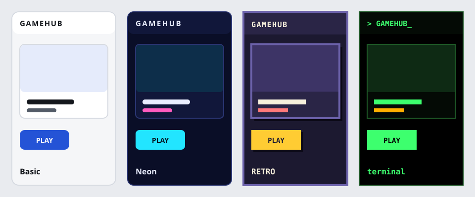

직접 만든 브라우저 게임을 한곳에 모아두려고 **GAMEHUB**를 만들었어요. 설치 없이 브라우저에서 바로 플레이할 수 있어요.

## 지금 할 수 있는 것

- 게임 목록을 태그로 거르고 검색하기
- 게임 페이지에서 바로 플레이, 전체화면, 링크 복사
- 설정에서 테마 4종(베이식, 네온, 레트로, 터미널)과 언어(한국어/English) 바꾸기
- 이 데브로그에서 업데이트 소식 보기



## 만든 방식

프레임워크 없이 *순수 HTML, CSS, JavaScript*로 만들었어요. 빌드 과정이 없어서 GitHub Pages에 파일을 그대로 올리면 끝이에요. 게임을 추가할 때는 `games/<id>/` 폴더 하나만 만들면 돼요.

```txt
games/my-game/
  index.html
  game.json
  thumb.png
```

> 버그나 아이디어가 있으면 언제든 알려 주세요.

첫 게임은 [PONG](#/game/pong)이에요.
